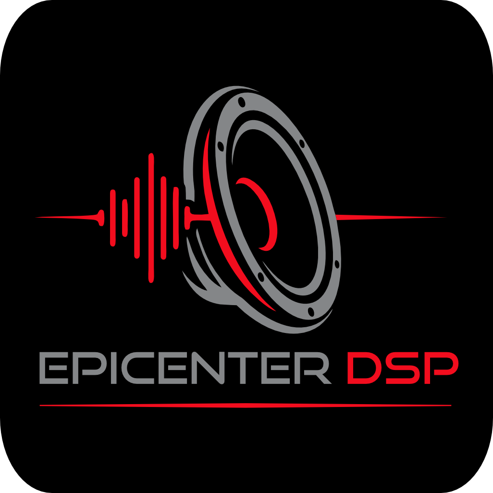

# EpicenterDSP Windows — Professional

Aplicación nativa WinUI 3 para controlar Epicenter DSP, un motor C++ de
reconstrucción de graves, mediante un Windows Endpoint Effect APO.



## Estado actual

Proyecto de desarrollo: **todavía no hay un instalador comercial validado**.
La interfaz y las pruebas funcionan; la carga del APO en `audiodg.exe` y el audio
real de la instalación componentizada siguen pendientes de validación.

El paquete de desarrollo se preparó específicamente para una salida digital
ALC892/SPDIF inspeccionada. No es un instalador universal de tarjetas de sonido.
La firma local de desarrollo no es una firma Microsoft/WHQL ni es de confianza
para Windows automáticamente. No se incluyen claves, certificados privados,
herramientas descargadas ni paquetes firmados en este repositorio.

No cambies permisos de endpoints ni desactives protecciones de Windows para
resolver una conexión. Consulta [la prueba local](PRUEBA_APO.md) y
[el estado de despliegue](docs/APO_DEPLOYMENT_PLAN.md) antes de instalar.

## Interfaz

- Logo e icono EpicenterDSP originales; negro, gris y rojo.
- Ventana centrada y label “By EpicenterDSP Labs”.
- Perilla 0–100% con arrastre, rueda, ajuste fino con Shift y animación continua.
  0% solicita bypass; la animación visual no retrasa el envío al APO.
- ON/OFF, escucha A/original y B/Epicenter, presets y diagnóstico.
- Medición PEAK/RMS de salida cuando existe telemetría válida. Entrada N/A:
  el contrato IPC actual no proporciona medición pre-DSP.
- Reconexión con reenvío de los últimos controles y estados explícitos de motor.
- Ajustes guardados cuando termina el movimiento y al cerrar la ventana.

## Arquitectura

`WinUI 3 → servicios/IPC SeqLock → EFX APO → EpicenterDSP Core C++17`.

C# controla y monitorea; no procesa audio. El Core y el contrato IPC de
producción se conservaron. El A/B utiliza un crossfade lineal de 8 ms.

El objetivo APO cubre audio del pipeline compartido de Windows en una salida
vinculada. WASAPI Exclusive, ASIO y passthrough comprimido pueden evitar ese
procesamiento; no se promete cobertura del 100% del audio.

## Compilar y verificar

Entorno local verificado: Windows 11 x64, Visual Studio 2022/MSVC v143,
Windows SDK, CMake 3.20+ y .NET SDK 9. Las dependencias WinUI se restauran
desde las versiones fijadas en el proyecto. .NET 9 no es LTS; la migración al
runtime LTS queda pendiente antes de una distribución comercial.

```cmd
BUILD_ALL.bat
```

Compila x64 Release y ejecuta las pruebas, **sin instalar ni cambiar Windows**.
La interfaz queda en:

```text
dist/EpicenterDSP Windows Actualizado/EpicenterDSP Windows.exe
```

Conserva toda esa carpeta: la compilación actual no es un EXE único portable.
El EXE de `epicenter-windows/dist` corresponde al prototipo legacy, no a esta UI.

Última validación local: Core 17/17, APO legacy 16/16, APO componentizado 16/16
y UI/IPC/servicios 29/29: **78 pruebas aprobadas**.
Estas pruebas no sustituyen una prueba de instalación y audio real.

## Estructura

- `epicenter-core/`: motor portable y regresión contra el legacy.
- `epicenter-apo/`: APO legacy, build componentizada y pruebas aisladas.
- `epicenter-ui/`: interfaz WinUI 3 y servicios.
- `epicenter-windows/`: prototipo histórico WASAPI/VB-CABLE.
- `scripts/`: compilación, verificaciones y preparación offline de paquetes.
- `docs/`: investigación y límites de despliegue.

Los activadores legacy se conservan para desarrollo/restauración con respaldo,
pero Windows rechazó el método de escritura directa en el PC de prueba.
No son el instalador componentizado nuevo ni restauran una configuración
“de fábrica”: únicamente pueden restaurar valores previamente respaldados.

## Licencia

Epicenter DSP Professional es propiedad de su autor. Todos los derechos reservados.
